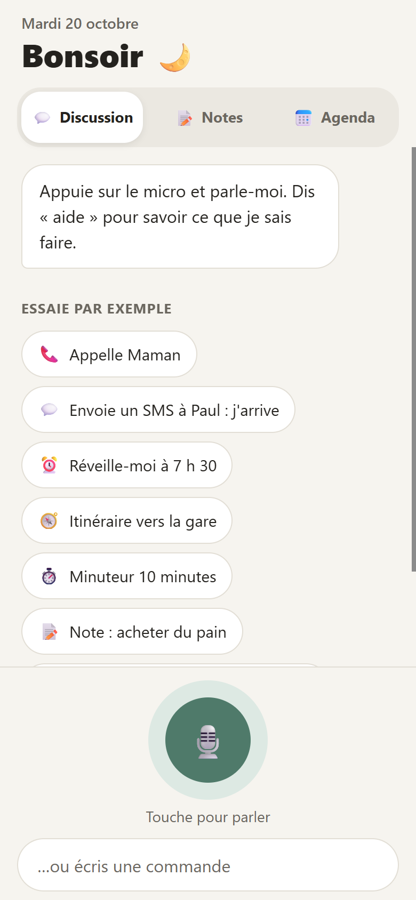
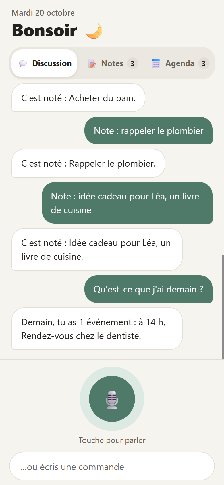
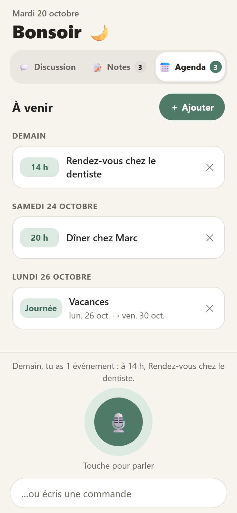
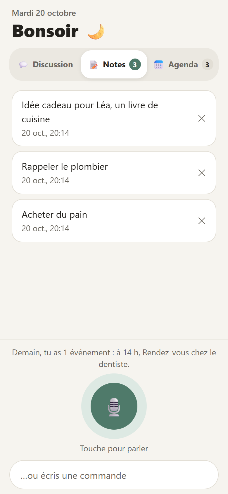
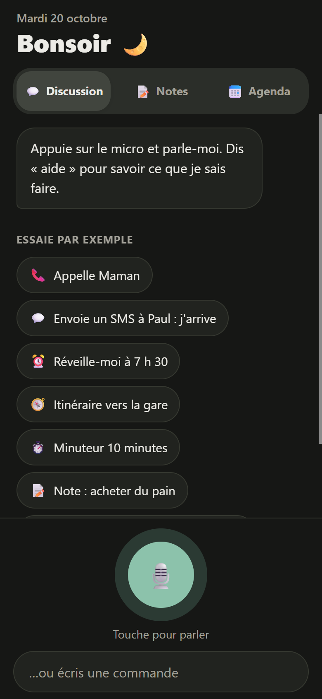

<p align="center">
  
</p>

# Assistant vocal

Une appli Android pour piloter son téléphone à la voix, en français.
100 % gratuite : pas d'IA payante, pas de serveur. La voix reste sur le
téléphone quand le pack « reconnaissance hors connexion » français est installé.

<p align="center">
  
  
  
  
</p>
<p align="center">
  <br />
  <em>Suit le mode clair / sombre du téléphone.</em>
</p>

## Ce qu'on peut dire

| Catégorie | Exemples |
|---|---|
| Appels | « Appelle Maman », « Appelle le 06 12 34 56 78 » |
| SMS | « Envoie un SMS à Paul : j'arrive », « Dis à Léa que je suis en retard » |
| Applis | « Ouvre WhatsApp », « Lance l'appareil photo », « Ouvre les paramètres Wi-Fi » |
| Web | « Cherche recette de crêpes », « Météo à Lyon », « C'est quoi la capitale du Pérou ? » |
| Trajets | « Itinéraire vers la gare », « Emmène-moi au travail » |
| Alarmes | « Réveille-moi à 7 h 30 », « Alarme à 8 heures du soir » |
| Minuteurs | « Minuteur 10 minutes », « Compte à rebours de 45 secondes » |
| Notes | « Note : acheter du pain », « Lis mes notes », « Ouvre mes notes », « Efface mes notes » |
| Agenda | « Rendez-vous chez le dentiste mardi à 14 h », « Ajoute à l'agenda vacances du 26 au 30 octobre », « Qu'est-ce que j'ai demain ? », « Est-ce que je suis libre jeudi ? », « Mes rendez-vous de la semaine », « Annule le dentiste » |
| Rappels | « Rappelle-moi d'appeler le garage dans 1 heure », « Rappelle-moi demain à 9 h de payer le loyer » |
| Divers | « Quelle heure est-il ? », « On est quel jour ? », « Aide » |

Pas de micro sous la main ? On peut aussi écrire la commande au clavier, ou
toucher un des exemples de l'écran d'accueil.

## Agenda et notes

L'onglet **Agenda** liste ce qui arrive, jour par jour. Le bouton **Ajouter**
ouvre un formulaire : quoi, quand, où, notes. Toucher une adresse ouvre
l'itinéraire. À la voix, on peut aussi noter quelque chose sur plusieurs jours
(« vacances du 26 au 30 octobre », « festival lundi pendant 3 jours »).

Les **notes** et l'**agenda** appartiennent à l'appli : ils sont enregistrés
dans l'appli elle-même, sans lire ni modifier les notes ou le Google Agenda du
téléphone. Désinstaller l'appli les efface.

L'appli envoie sa propre alerte : 30 minutes avant une entrée qui a une heure,
sinon le jour même à 8 h.

Par sécurité, l'app ne passe jamais un appel ni n'envoie un SMS toute seule :
elle prépare tout, et c'est toi qui appuies sur « Appeler » / « Envoyer ».

## Où est quoi

- `src/lib/parser.ts` — comprend la phrase (« réveille-moi à 7h » → alarme 7:00). **Pour ajouter une tournure, c'est ici.**
- `src/lib/actions.ts` — exécute la commande, choisit la phrase de réponse, et liste les exemples de l'accueil.
- `src/lib/agenda.ts` / `src/lib/notes.ts` — l'agenda et les notes de l'appli.
- `src/components/AgendaScreen.tsx` / `EventForm.tsx` — l'onglet Agenda et le formulaire « Ajouter ».
- `src/lib/apps.ts` — la liste des applis qu'on sait ouvrir par leur nom.
- `src/theme.ts` — les couleurs (clair et sombre).
- `App.tsx` — l'écran principal.

## Commandes

```bash
npm run test:parser     # vérifie que les phrases d'exemple sont bien comprises
npx expo run:android    # compile et installe sur le téléphone branché en USB
npx expo start --dev-client   # ensuite, pour recharger le code en direct
npx expo start --web    # aperçu dans le navigateur du PC (sans micro ni alertes)
```
